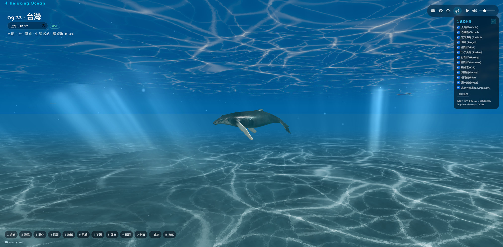
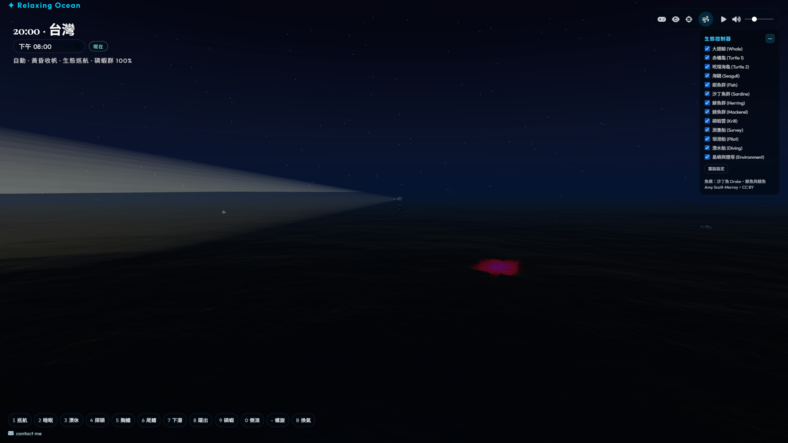

# Relaxing Ocean TV

Android TV app for [Relaxing Ocean](https://relaxingocean.cc.cd/). It opens the live page full screen, and it can also run as the television screensaver.

The pictures below are the live website. The left clock is Taiwan time. The morning picture is 09:22, and the evening picture is 19:21.

## Morning



## Evening



## Language

The page follows the browser language. Traditional Chinese is used when that language starts with zh. English is used for every other language. There is no language button on the page. The television app shows the language set on the television.

## How to use the website

Open https://relaxingocean.cc.cd/. The opening screen enters the ocean by itself after about five seconds. Click it to enter sooner.

The time field under the clock changes the scene. Choose a morning hour or an evening hour. Now returns to the current Taiwan time. On a Chinese page that button says 現在.

Top right, from left to right:

- Gamepad: manual control
- Eye: underwater view
- Crosshair: camera back behind the whale
- Wind: breath
- Play: pause or resume
- Speaker and slider: mute and volume

The list on the right turns creatures, boats, and the island on or off. The buttons along the bottom play one action: Cruise, Sleep, Log, Spyhop, Pec, Tail, Dive, Breach, Krill, Roll, Spin, Breath. On a Chinese page those buttons are 巡航, 睡眠, 漂休, 探頭, 胸鰭, 尾鰭, 下潛, 躍出, 磷蝦, 側滾, 螺旋, 換氣.

## Television remote

Direction keys move the ring. Center presses the focused control. Left and right on the volume slider change it a little at a time.

On the gamepad button, Center starts manual control:

- Up swims forward and keeps going
- Left turns left, Right turns right
- Down stops
- Back leaves manual control

Back again leaves the app.

## Screensaver

On the television, open Settings, Device Preferences, Screensaver, and choose 海洋之歌. The picture stays bright. Any remote key leaves the screensaver.

## Download

The v1.0 release is one signed universal APK. This app has no native code, so the same package runs on every Android TV CPU.

https://github.com/chihochangai-hash/relaxing-ocean-tv/releases/download/v1.0/relaxing-ocean-tv-1.0.apk

It is an Android TV app. A television that already has a debug build of 海洋之歌 must remove that copy before installing this one, because the signatures differ.

## Build

Android SDK 35, Java 17, Gradle 8.9.

```
gradlew assembleDebug
```

`gradlew assembleRelease` signs the package when `keystore.properties` is present. That file and the keystore stay off the repository.

## 下載

v1.0 是一隻已簽名的通用 APK，沒有依 CPU 拆開。這支 app 沒有原生程式庫，同一包可用在各種 Android TV。

https://github.com/chihochangai-hash/relaxing-ocean-tv/releases/download/v1.0/relaxing-ocean-tv-1.0.apk

這是 Android TV 用的 app。電視上如果已經裝過偵錯版的海洋之歌，要先移除再裝這一包，因為簽名不同。

## 操作說明

上面兩張是網站畫面。左上時鐘是台灣時間，早上那張是 09:22，晚上那張是 19:21。

## 語系

畫面跟著瀏覽器語系。語系是中文時用繁體中文，其他語系用英文。頁面上沒有切換語言的按鈕。電視 app 顯示電視設定的語系。

英文時，時鐘寫 Taiwan，回到目前時間的按鈕是 Now。下方按鈕是 Cruise、Sleep、Log、Spyhop、Pec、Tail、Dive、Breach、Krill、Roll、Spin、Breath。

打開 https://relaxingocean.cc.cd/ 。開始畫面約五秒後自己進入海洋，也可以直接點進去。

時鐘下面的時間可以改場景。選早上或晚上的鐘點。按「現在」回到台灣目前時間。

右上角由左到右：

- 手把：手動控制
- 眼睛：水下視角
- 準心：鏡頭回到鯨魚後方
- 風：換氣
- 播放：暫停或繼續
- 喇叭與音量條：靜音和音量

右邊清單可以開關生物、船和島嶼。下方按鈕各播放一個動作：巡航、睡眠、漂休、探頭、胸鰭、尾鰭、下潛、躍出、磷蝦、側滾、螺旋、換氣。

電視遙控器的方向鍵移動光圈，中鍵按下。音量條用左右微調。

光圈停在手把時按中鍵進入手動控制：

- 上鍵往前游，鬆開也繼續
- 左鍵往左轉，右鍵往右轉
- 下鍵停止
- 返回鍵離開手動控制

再按一次返回離開 app。

螢幕保護程式在電視的設定、裝置偏好設定、螢幕保護程式，選擇海洋之歌。畫面保持亮著，按任何遙控器鍵就離開。
